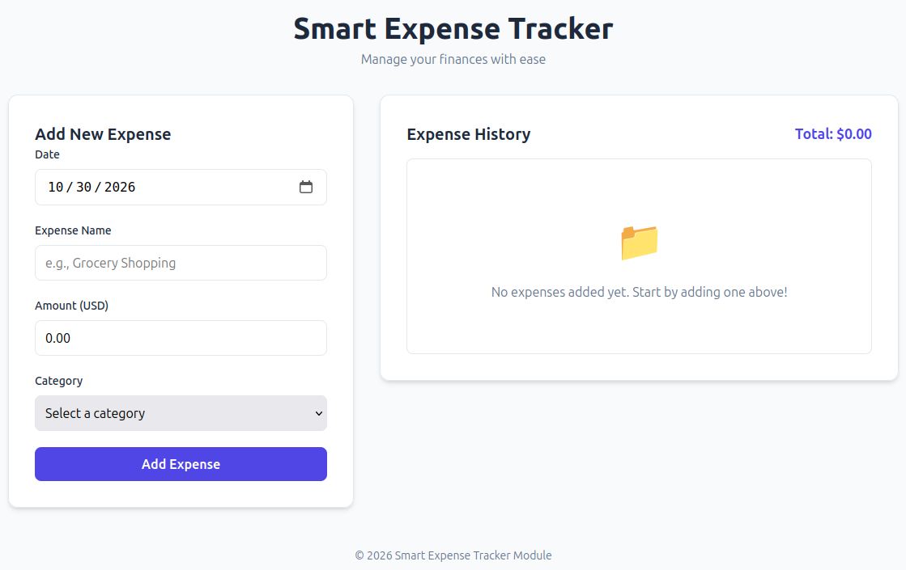
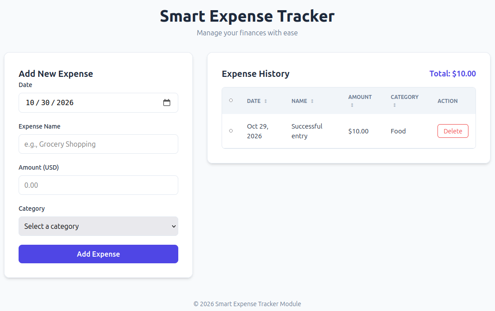
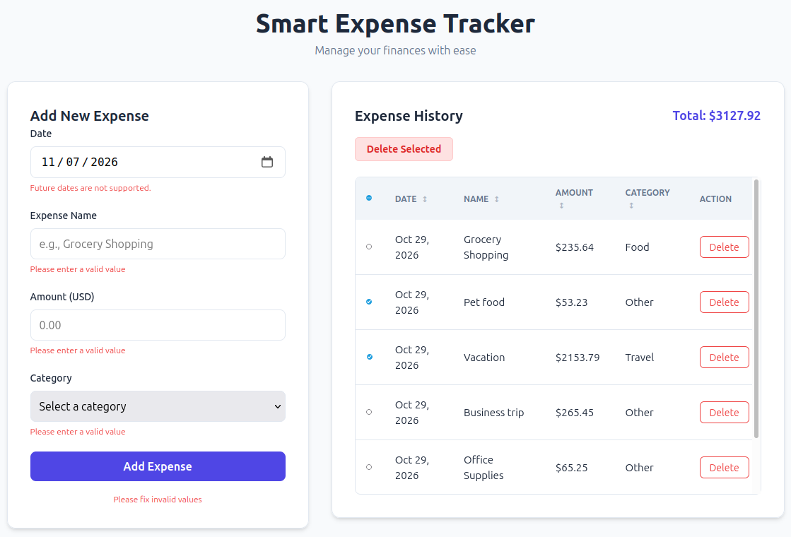
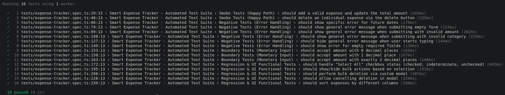

# Smart Expense Tracker

A modern, intuitive web application designed to help you manage your daily finances with ease. Track your expenses, categorize them, and keep a clear history of your spending habits.

---

## 📸 App Showcase

### 1. Empty State 
*When no expenses have been recorded.*



### 2. Successful Entry 
*A valid expense successfully added to the history.*



### 3. Error Handling
*Visual feedback for invalid inputs (e.g., future dates or empty fields).*



---

## 🚀 Features

- **Add New Expenses**: Quickly record expenses with date, name, amount, and category.
- **Smart Validation**:
    - Prevents future date entries with real-time visual feedback.
    - Validates monetary amounts (ensures correct decimal format).
    - Real-time error messaging for empty or invalid fields.
- **Expense History**: A clean, sortable table to view all your recorded expenses.
- **Categorization**: Organize spending by Food, Travel, Shopping, or Other.
- **Bulk Actions**: Easily delete multiple selected expenses at once.
- **Dynamic Totals**: Automatically calculates and displays your total expenditure.
- **Interactive UI**: Sortable columns and a custom confirmation modal for deletions.

## 🛠️ Technologies Used

- **HTML5**: Semantic structure for the application.
- **CSS3**: Custom styling with a modern, responsive design and CSS variables.
- **JavaScript (ES6+)**: Core application logic and state management.
- **Playwright**: Robust automated end-to-end testing suite.

## 🏃 How to Run

### Prerequisites

- A local web server (e.g., VS Code Live Server, `http-server`, or Python's `http.server`).

### Steps

1. **Clone the repository** to your local machine.
2. **Start a local web server** in the project root directory. For example, using Python:
   ```bash
   python3 -m http.server 5500
   ```
3. **Open your browser** and navigate to:
   ```
   http://localhost:5500
   ```

---

## 🧪 Test Results

The application is covered by a comprehensive suite of automated tests using Playwright, including Smoke, Boundary, Negative, and Regression tests.

To run the tests, use the following command:

```bash
npx playwright test
```

### Test Execution Output


---

## 📝 Development Process & Improvements

### Iterative Improvement: Enhanced Error Messaging

During the testing phase, I observed that the initial implementation used a standard browser `alert()` popup when a user attempted to select a future date. While functional, this was disruptive to the user experience and felt disconnected from the app's modern design.

**The Improvement:**
I used iterative prompting to replace the browser alert with a custom, in-line error message (using the `.error-text` class). This change provides immediate, non-intrusive visual feedback directly within the form, creating a much more seamless and professional user experience.

---

# 📜 Prompting History

This section contains the key prompts used to develop the Smart Expense Tracker, demonstrating the use of structured prompting, task decomposition, and iterative refinement.

## 1. Initial Structured Prompt (Skeleton Phase)

**Role:** Senior Frontend Developer.

**Context:** I am a student in a vibe coding bootcamp working on a module assignment. I am building a "Smart Expense Tracker" web application. The project is intended to be a **Node.js based application**, but for this initial phase, we are focusing strictly on the frontend foundation.

**Task:** Create the initial project skeleton, specifically the HTML5 structure and the basic CSS styling.

**Constraints:**
- **Technology:** Use **only** vanilla HTML and CSS. Do **not** use any frameworks like Bootstrap, Tailwind, or React.
- **Input Form Requirements:** The HTML must include a form with the following fields:
    - **Date**: A date picker. *Requirement: Prepared to default to today's date via JS later.*
    - **Name**: A text input.
    - **Amount**: A number input. *Requirement: Supports monetary values (two decimal places) and represents USD.*
    - **Category**: A dropdown menu (options: Food, Travel, Shopping, Other).
- **Validation & Error Handling (Structure/Style):**
    - **Mandatory Fields:** All fields (Date, Name, Amount, Category) must be marked as **required**.
    - **Error UI:** The CSS must include styles for error messages (e.g., a `.error-text` class).
    - **Visibility:** These error messages must be **hidden by default** (e.g., `display: none;`) and should only appear in **red** when triggered by the user attempting to submit an empty field.
- **Display Area Requirements:**
    - **Empty State:** The display area must include a placeholder element (e.g., a `div` or `img` container) to show an **"Empty State" icon/message** when no expenses have been added. This placeholder should be visible by default.
    - **Scrollable List:** The expense list must be in a container that is **scrollable** (e.g., using `overflow-y: auto` with a defined height or max-height) to accommodate a large number of entries.
    - **Columns:** Each entry in the list/table must show: **Expense Date, Name, Amount, Category, and a Delete Button**.
    - **Structural Prep for Delete:** The Delete button should be included in the HTML structure, prepared for a future JavaScript implementation that will trigger a confirmation prompt.
- **Styling Requirements:**
    - The design should be modern, clean, and professional (e.g., plenty of whitespace, subtle shadows, and a clear typography hierarchy).
    - The layout must be responsive (work well on both desktop and mobile).
    - Use a pleasant, neutral color palette.

**Examples:** Think of a modern, minimalist budgeting app—clean cards, easy-to-read numbers, an intuitive scrollable history, and a friendly icon when the list is empty.

**Output Format:** Provide two separate, complete code blocks: one for `index.html` and one for `style.css`.

**Success Criteria:** When `index.html` is opened in a web browser, the user should see a visually complete, professional-looking interface. The form must include all required fields with error messages hidden, and the display area must show the "Empty State" placeholder and a scrollable container ready for data.

---

## 2. Follow-up Prompt (Implementation Phase)

**Role:** Senior Frontend Developer.

**Context:** I have the initial "Skeleton" for my "Smart Expense Tracker." I am now moving into the advanced implementation phase. I am using **Vanilla JavaScript** and following the principles of task decomposition and prompt chaining.

**Task:** Implement the full logic for the Expense Tracker. Because of new requirements, you must provide **updated versions of `index.html`, `style.css`, and a complete `script.js`**.

**Requirements & Logic:**
1. **Data Management & Initialization:** Manage a central array of expense objects. On load, default the "Date" input to **today's date**. The "Empty State" icon/message must be visible by default.
2. **Adding an Expense:** 
    - **Validation:** If any field is empty, show a red `.error-text` message. 
    - **Formatting:** The "Amount" must be stored and displayed as **USD with exactly two decimal places**.
    - **UI Update:** Hide the "Empty State," add the new row to the list, and update the "Total Amount Spent."
3. **Advanced Selection Logic:** Implement a "Select All" system with **Indeterminate** state support and a Bulk Delete button.
4. **Sorting Logic:** Implement clickable table headers for sorting (Date, Name, Amount, Category).
5. **Standard Deletion:** Implement individual row deletion.

**Constraints:** Strictly Vanilla JavaScript, HTML5, and CSS3. No frameworks.

---

## 3. Iterative Refinement (Bug Fix & UX Improvement)

**Prompt:**
"Fix the following issues:
- The Date field should not allow future dates. If a future date is selected, display the following red alert message: 'Future dates are not supported.'
- If the Expense Name, Amount (USD), or Category fields are blank, a red alert should pop up with the following message 'Please enter a valid value'.
- When expense fields have empty or invalid values and the user clicks the Add Expense button, a red alert message should appear under the Add Expense button which states: 'Please fix invalid values'"
