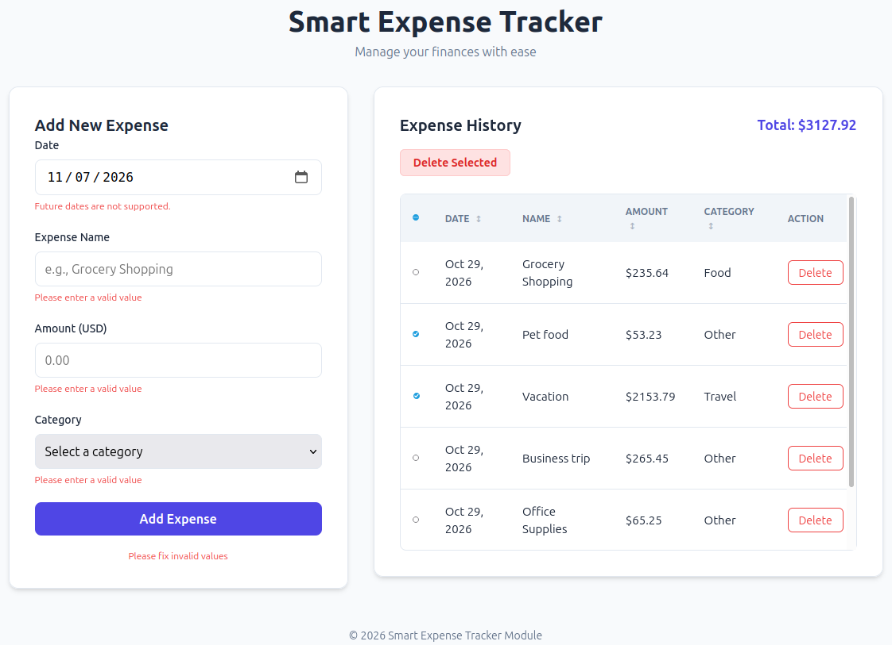

# Smart Expense Tracker

A modern, intuitive web application designed to help you manage your daily finances with ease. Track your expenses, categorize them, and keep a clear history of your spending habits.



## 🚀 Features

- **Add New Expenses**: Quickly record expenses with date, name, amount, and category.
- **Smart Validation**:
    - Prevents future date entries with real-time visual feedback.
    - Validates monetary amounts (ensures correct decimal format).
    - Real-time error messaging for empty or invalid fields.
- **Expense History**: A clean, sortable table to view all your recorded expenses.
- **Categorization**: Organize spending by Food, Travel, Shopping, or Other.
- **Bulk Actions**: Easily delete multiple selected expenses at once.
- **Dynamic Totals**: Automatically calculates and displays your total expenditure.
- **Interactive UI**: Sortable columns and a custom confirmation modal for deletions.

## 🛠️ Technologies Used

- **HTML5**: Semantic structure for the application.
- **CSS3**: Custom styling with a modern, responsive design and CSS variables.
- **JavaScript (ES6+)**: Core application logic and state management.
- **Playwright**: Robust automated end-to-end testing suite.

## 🏃 How to Run

### Prerequisites

- A local web server (e.g., VS Code Live Server, `http-server`, or Python's `http.server`).

### Steps

1. **Clone the repository** to your local machine.
2. **Start a local web server** in the project root directory. For example, using Python:
   ```bash
   python3 -m http.server 5500
   ```
3. **Open your browser** and navigate to:
   ```
   http://localhost:5500
   ```

## 🧪 Test Results

The application is covered by a comprehensive suite of automated tests using Playwright, including Smoke, Boundary, Negative, and Regression tests.

To run the tests, use the following command:

```bash
npx playwright test
```

### Current Test Status

| Test Suite | Status |
| :--- | :--- |
| Smoke Tests (Happy Path) | ✅ Passed |
| Negative Tests (Error Handling) | ✅ Passed |
| Boundary Tests (Monetary Input) | ✅ Passed |
| Regression & UI Functional Tests | ✅ Passed |

*All 16 tests passed successfully in recent runs.*
